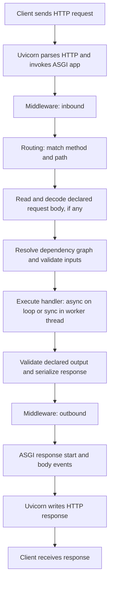

# T02 - Day 2: Runtime architecture and a working app

Date: 2026-11-08 (Asia/Calcutta).
Scope: all six T02 items in [TODO_TASKS.md](TODO_TASKS.md).
Format: interview revision explanations, comparison tables, and a request-flow
diagram. The selected endpoint scope is `GET /health`.

## 1. Who does what?

### Q1. How do FastAPI, Starlette, Pydantic, and Uvicorn fit together?

**30-second answer:** Uvicorn accepts network connections and calls our ASGI
application. FastAPI connects route signatures, dependencies, validation, and API
documentation. It builds on Starlette's web primitives and uses Pydantic to
interpret typed data contracts.

| Component | Responsibility | What it does in this project |
| --- | --- | --- |
| Uvicorn | ASGI server: networking, protocol handling, and invoking the app. | Imports `app.main:app` and listens on localhost. |
| Starlette | ASGI web toolkit: routing foundations, middleware, request/response objects, lifespan, and WebSocket primitives. | Supplies the underlying web machinery and test-client implementation. |
| Pydantic | Validates typed data and supports serialization and JSON Schema generation. | Validates settings now; domain schemas arrive in T05. |
| FastAPI | Builds API operations from type annotations, resolves dependencies, integrates validation, and generates OpenAPI. | Registers `/health` and the documentation routes. |

These are collaborating components, rather than four interchangeable servers.
See [FastAPI features](https://fastapi.tiangolo.com/features/) and
[Pydantic models](https://docs.pydantic.dev/latest/concepts/models/).

### Q2. Does a Python type hint validate data by itself?

No. FastAPI and Pydantic inspect annotations and apply runtime validation.
A plain Python function does not acquire validation just because it has hints.
Pydantic may coerce compatible input by default; strict rejection is a separate
choice. Database stock availability still belongs in the service/transaction
layer. See [Pydantic models](https://docs.pydantic.dev/latest/concepts/models/).

## 2. FastAPI versus Flask versus Django

### Q3. How would you compare the frameworks in an interview?

Compare their defaults and the application's needs before making performance
claims. None of the three names alone establishes throughput.

| Aspect | FastAPI | Flask | Django |
| --- | --- | --- | --- |
| Core interface | ASGI. | WSGI. | Supports ASGI and WSGI deployment. |
| Typical scope | Typed HTTP APIs. | Small core with application-selected extensions. | Integrated web framework. |
| API contracts | Annotation-driven validation and OpenAPI built in. | Add validation and API-schema tooling as needed. | API-specific contracts commonly use additional tooling. |
| Database/admin | Choose ORM, migrations, and admin tooling. | Choose database/admin extensions. | Includes ORM, migrations, authentication, and an admin site. |
| Async caveat | Blocking work can still stall the loop. | Async views under WSGI still occupy a request worker. | Sync middleware or sync-only components can require adaptation. |

**Project decision:** FastAPI matches this capstone's goals of learning typed
contracts, dependency injection, ASGI execution, and streaming. This is a
learning choice, not a measured claim that another framework is slower.

Framework scope references:
[FastAPI features](https://fastapi.tiangolo.com/features/),
[Flask design](https://flask.palletsprojects.com/en/stable/design/),
and [Django overview](https://docs.djangoproject.com/en/6.0/intro/overview/).
Async caveats:
[Flask async support](https://flask.palletsprojects.com/en/stable/async-await/)
and [Django async support](https://docs.djangoproject.com/en/6.0/topics/async/).

**Follow-up: Can Flask or Django use async code?** Yes. Flask supports coroutine
views with its async extra, but that does not turn its WSGI request lifecycle
into an ASGI-native one. Django supports an async request stack under ASGI;
check the deployed version and middleware rather than assuming every operation
is async. See the framework async references above.

## 3. ASGI, WSGI, and execution models

### Q4. What is the difference between ASGI and WSGI?

They specify how a server and application communicate. They do not prescribe
one universal worker or threading model.

| Aspect | WSGI | ASGI |
| --- | --- | --- |
| Callable shape | `application(environ, start_response)`. | `await application(scope, receive, send)`. |
| Communication | Request environment, response metadata, iterable of body bytes. | Scope information plus asynchronous incoming/outgoing events. |
| Protocol scope | HTTP request/response. | HTTP, WebSockets, and lifecycle events through defined protocols. |
| Streaming | Can stream HTTP response chunks; concurrency depends on the server. | Can stream responses while awaiting I/O; disconnect/cancellation still need handling. |
| Concurrency | Server may use threads, processes, or other strategies. | Often event-loop based, with optional threads and worker processes. |
| What is not guaranteed | WSGI does not mean one request for the whole server. | ASGI does not make blocking application code non-blocking. |

SSE is HTTP streaming and is possible with either interface. WSGI itself has
no standard bidirectional WebSocket event protocol.
See [PEP 3333](https://peps.python.org/pep-3333/) and
[ASGI introduction](https://asgi.readthedocs.io/en/latest/introduction.html).

### Q5. How do concurrency and parallelism differ?

**Concurrency** means multiple tasks make progress during overlapping periods:
while one request waits on I/O, another can run. **Parallelism** means work
executes simultaneously, for example in different processes on different CPU
cores. A server can use both.

| Mechanism | Where execution happens | Main use and constraint |
| --- | --- | --- |
| Event-loop tasks | Cooperatively scheduled on a loop thread. | Overlap awaitable I/O; blocking work delays other tasks on that loop. |
| Worker threads | Separate threads in one process. | Isolate synchronous I/O; thread capacity is finite. |
| Worker processes | Separate processes with independent memory. | CPU parallelism and independent request loops; memory and resource pools are duplicated. |

In ordinary GIL-enabled CPython, threads do not generally parallelize
CPU-heavy Python bytecode. Native code that releases the GIL and optional
free-threaded builds need separate consideration. See
[Python threading and the GIL](https://docs.python.org/3.13/library/threading.html#gil-and-performance-considerations).

### Q6. Where do `async def` and `def` endpoints run?

FastAPI awaits async endpoints and dependencies on the event loop. It dispatches
ordinary synchronous endpoints and dependencies to worker threads. A normal
helper called directly inside an async handler runs inline: FastAPI does not
automatically move that helper to a thread.

Use async-native I/O with `await`, or explicitly offload blocking work. An
async declaration alone neither removes blocking nor makes CPU-heavy code
parallel. Our health handler does a tiny in-memory operation and needs no
`await`. See [FastAPI async execution](https://fastapi.tiangolo.com/async/).

Starlette uses AnyIO for thread offloading; capacity is shared with other
thread-offloaded work. A thread pool is not unlimited concurrency.
See [Starlette thread pool](https://starlette.dev/threadpool/).
The reproducible timing experiments belong to T08-T09.

### Q7. Is Uvicorn always using uvloop?

No. Loop selection depends on configuration and platform. uvloop is unsupported
on Windows; do not force it in this PowerShell development setup. A reload
supervisor is not an extra request-serving worker. Uvicorn's `--reload` and
`--workers` options are mutually exclusive.
See [Uvicorn settings](https://uvicorn.dev/settings/).

## 4. Request-flow diagram

This is the conceptual flow for a normal JSON API operation. The diagram groups
dependency resolution with input validation because each dependency can have
its own validated inputs and sub-dependencies.



**Walkthrough:** The server translates the network request into ASGI information
and events. Middleware surrounds routing and handler work. FastAPI matches the
operation, binds inputs, resolves dependencies, and calls the handler. Returned
data is checked against the declared output contract and serialized before the
server sends it.

Middleware can short-circuit before routing, and responses unwind through the
surrounding stack. There is no application-defined middleware yet; framework
middleware still exists.
See [Starlette middleware](https://starlette.dev/middleware/).

Input validation is part of resolving the dependency graph, rather than a
guarantee that every endpoint input is validated before any dependency runs.
See [FastAPI dependencies](https://fastapi.tiangolo.com/tutorial/dependencies/).

### Q8. What happens when a request fails?

| Failure | Typical result in this API |
| --- | --- |
| No matching path | 404. |
| Path exists but method is unsupported | 405, with an `Allow` header. |
| Declared request inputs fail validation | 422; the endpoint handler is not executed. |
| An intentional HTTP error is raised | Its status/detail are handled by the framework. |
| Handler output violates its declared contract | Server error; it is a server bug. |
| An unexpected exception escapes | 500; with debug disabled, no traceback response. |

This success-path diagram omits error branches. Errors can be handled at
different middleware layers, so do not assume all outbound hooks execute after
every unexpected exception. See
[Starlette exceptions](https://starlette.dev/exceptions/),
[FastAPI request errors](https://fastapi.tiangolo.com/tutorial/handling-errors/), and
[FastAPI response validation](https://fastapi.tiangolo.com/tutorial/response-model/).

**Actual `/health` path:** The GET operation declares no body, authentication,
or request dependency. It returns `{"status":"ok"}`; the `dict[str, str]`
return annotation supplies a simple output contract. Settings load when the
application is created, rather than as a per-request dependency. Returning a
Response object directly would bypass the normal returned-data validation and
serialization path; see the response-model reference above.

## 5. Application layout and the health contract

```text
app/
  __init__.py
  main.py                # create_app(...) and ASGI app
  api/
    __init__.py
    deps.py              # shared request dependencies, later
    v1/
      __init__.py        # auth/inventory/order routers, T03
  core/
    __init__.py
    config.py            # existing validated settings
  models/
    __init__.py          # database models, T13
  schemas/
    __init__.py          # domain input/output schemas, T05
  services/
    __init__.py          # business operations and transactions, later
tests/
  test_config.py
  test_health.py
exercises/
  README.md              # isolated experiments, later
main.py                  # existing learning script
```

### Q9. Why separate routes, schemas, models, and services?

Routes translate HTTP inputs/outputs, schemas define public data contracts,
models describe persistence, and services own business operations. A future
order service will own checkout rules and transaction boundaries, keeping them
out of route handlers. These directories are placeholders until their tasks;
creating them does not implement inventory, orders, or a database.

### Q10. Why use an application factory?

`create_app(settings)` returns a fresh FastAPI instance. Tests can supply
explicit settings without relying on a developer's `.env`. The exported
`app = create_app()` keeps the Uvicorn entry point simple. App title and debug
behavior come from the validated T01 settings.

| Contract | T02 behavior |
| --- | --- |
| Method/path | `GET /health`, outside the business `/api/v1` prefix. |
| Access | Public; no bearer-credential inspection. |
| Success | 200, `application/json`, `{"status":"ok"}`. |
| Meaning | Application liveness: this process can respond. |
| External checks | None; no database or outbound HTTP calls. |

**Interview distinction:** Liveness and readiness answer different operational
questions. An app may respond while a required database is unavailable. The
T01 readiness contract remains planned; `/health/ready` is outside T02 scope
by the selected preference.

## 6. Run, inspect, and test

### Q11. How do I start the correct app?

From the repository root, in PowerShell or Bash/zsh:

```sh
uv run --locked uvicorn app.main:app --host 127.0.0.1 --port 8000 --reload
```

`app.main` is the Python module and `app` is its exported ASGI object.
The root `main.py` is a separate learning script. `--reload` is for local
development. Keep the current lockfile; T02 requires no new dependency.
See [Uvicorn settings](https://uvicorn.dev/settings/).

| URL | What to inspect |
| --- | --- |
| http://127.0.0.1:8000/health | 200 and `{"status":"ok"}`. |
| http://127.0.0.1:8000/docs | Swagger UI; expand GET /health and use Try it out. |
| http://127.0.0.1:8000/redoc | ReDoc's alternative reference view. |
| http://127.0.0.1:8000/openapi.json | Machine-readable contract; inspect `paths["/health"]["get"]`. |

Swagger UI and ReDoc render the generated OpenAPI document; they are not
independent API definitions. The default HTML loads UI assets from external
CDNs, so receiving HTML is weaker evidence than rendering it in a browser.
See [FastAPI first steps](https://fastapi.tiangolo.com/tutorial/first-steps/).

PowerShell requests:

```powershell
Invoke-RestMethod http://127.0.0.1:8000/health
(Invoke-RestMethod http://127.0.0.1:8000/openapi.json).paths.'/health'.get
```

Bash/zsh requests:

```sh
curl -i http://127.0.0.1:8000/health
curl -s http://127.0.0.1:8000/openapi.json
```

### Q12. How can a synchronous test exercise an async app?

The normal `def test_health_returns_ok()` uses FastAPI's `TestClient`.
It drives the ASGI app through an in-process transport, without a listening
Uvicorn socket. Its synchronous request API does not turn the async endpoint
into a synchronous endpoint.
See [FastAPI testing](https://fastapi.tiangolo.com/tutorial/testing/).

Using `with TestClient(...)` also runs application startup/shutdown and closes
the client. There are no custom lifespan resources yet.
See [Starlette TestClient](https://starlette.dev/testclient/).

`pyproject.toml` uses pytest's `[tool.pytest]` table (supported since pytest 9).
`testpaths = ["tests"]` bounds default collection, and `pythonpath = ["."]`
makes the app importable from the repository root. No async pytest plugin is
needed for this synchronous smoke test.
See [pytest configuration](https://docs.pytest.org/en/stable/reference/customize.html).

Run the complete current suite and style checks:

```sh
uv run --locked python -m pytest -q
uv run --locked ruff check app tests
uv run --locked ruff format --check app tests
uv lock --check --offline
uv pip check
```

The smoke test checks the 200 status, JSON content type, and exact payload.
A separate live Uvicorn inspection is needed to check the server/import target
and real HTTP serving. Neither proves database behavior or concurrency
performance; those features have later tasks.

## 7. Completion evidence and interview recall

Verified on 2026-11-08 on Windows using Python 3.13.17 and the existing lockfile.
Installed versions: FastAPI 0.162.1, Starlette 1.10.0, Pydantic 2.14.3,
Uvicorn 0.54.0, pytest 9.2.0, HTTPX 0.28.1, and Ruff 0.17.4.

| Check | Observed result |
| --- | --- |
| Full pytest suite | 6 tests pass: 5 configuration cases and 1 health smoke test; 1 Starlette deprecation warning. |
| Ruff lint and format check | Pass for app and tests; final checks used --no-cache. |
| uv lock freshness and package compatibility | Both pass; dependencies and lockfile unchanged. |
| Live Uvicorn /health | 200 application/json with the exact agreed payload. |
| Live Uvicorn /docs and /redoc | 200 HTML; UI entry points and OpenAPI references inspected. |
| Live Uvicorn /openapi.json | 200 JSON; GET /health and its output schema inspected; no business routes or security schemes. |
| Readiness scope | /health/ready returns 404. |

The locked HTTPX 0.28.1 dependency triggers the deprecation warning in
Starlette 1.10.0. It remains a supported fallback; Starlette recommends
httpx2 for TestClient. The warning is not suppressed, and this task does not
change dependency versions. See
[Starlette TestClient](https://starlette.dev/testclient/).

The live check started a temporary Uvicorn subprocess on a server-assigned
localhost port and stopped it afterward. The HTML and schema were inspected
over real HTTP; browser rendering and external CDN availability were not
verified.

| T02 checklist item | Evidence |
| --- | --- |
| Runtime responsibilities and framework comparison | Sections 1-2, short answers and comparison tables. |
| Request-flow diagram | Section 4, Mermaid diagram, validation and failure explanations. |
| ASGI/WSGI and execution models | Section 3, interface and execution tables with platform caveats. |
| Application layout | Section 5 and the scaffold packages. |
| Running Uvicorn, health, and API documentation | Section 6 commands and the live HTTP inspection above. |
| Pytest configuration and synchronous smoke test | pyproject.toml and tests/test_health.py; full suite passes. |

All six T02 items are complete. Readiness and subsequent feature tasks remain
planned.

Practice these answers aloud:

1. Explain the role of each of the four runtime components in 30 seconds.
2. Compare the three frameworks without making an unmeasured speed claim.
3. Trace a successful request and explain where 422 and 500 differ.
4. Explain why a blocking helper inside an async route can delay other requests.
5. Distinguish an event-loop task, worker thread, and worker process.
6. Explain why a passing health check does not establish readiness.

Next: T03, modular auth/inventory/order routers and parameter validation.
